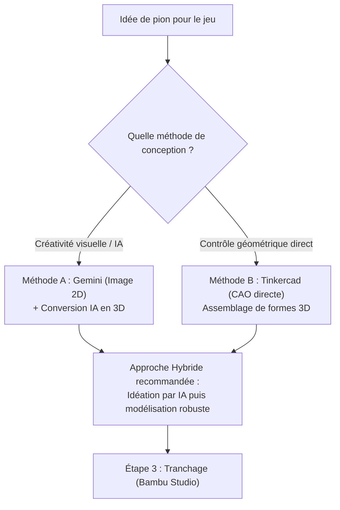
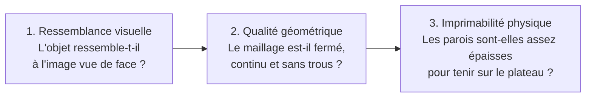

# 6.6. Concevoir les Pions à l'Imprimante 3D

::: info Extrait intégral des Notes de cours
Ce chapitre reproduit fidèlement et dans son intégralité les contenus didactiques et techniques du syllabus officiel du cours de Didactique du numérique (Master 1 - HECh, Point 11, pages 55 à 65) concernant la modélisation et la fabrication additive de pions de jeu de société.
:::

---

## 11.1. Le potentiel pédagogique de l'impression 3D dans les cours de numérique

L'impression 3D permet de passer de la conception numérique à la fabrication d'un objet physique. Elle offre aux élèves la possibilité de **devenir des concepteurs et des fabricants**, plutôt que de rester de simples utilisateurs des technologies.

### 1. Les principaux apports pédagogiques

- **Développer la créativité et la résolution de problèmes :** concevoir un objet qui répond à un besoin réel en respectant des contraintes techniques.
- **Comprendre la chaîne de production numérique :** passer de la modélisation 3D à la préparation du fichier, puis à la fabrication concrète.
- **Développer une démarche expérimentale :** fabriquer un prototype, tester son fonctionnement, identifier ses défauts et améliorer sa conception par itérations successives.
- **Mobiliser la pensée informatique :** décomposer un problème, organiser les étapes de réalisation et anticiper les contraintes matérielles.
- **Développer la collaboration :** répartir les rôles, confronter les propositions et construire une solution collective.
- **Questionner les enjeux du numérique :** réfléchir à la consommation de matière, à la réparation, aux déchets plastiques et à la fabrication locale.

::: warning Condition essentielle d'apprentissage
Ces apprentissages ne découlent pas automatiquement de la simple présence d'une imprimante 3D en classe. Ils nécessitent des **objectifs explicites**, des **contraintes de conception rigoureuses** et une **analyse réflexive des résultats obtenus**.
:::

---

### 2. Exemple d'activité : concevoir un support de smartphone ergonomique

#### Défi proposé aux élèves
Concevoir et fabriquer un support de smartphone adapté à une utilisation en classe, par exemple pour consulter une ressource numérique, filmer une expérience scientifique ou réaliser une visioconférence.

#### Objectif d'apprentissage
Concevoir un objet fonctionnel en utilisant un logiciel de modélisation 3D, puis vérifier sa conformité au cahier des charges par des tests réels.

#### Contraintes du défi
1. Le support doit maintenir un smartphone sans qu'il glisse.
2. Il doit être suffisamment stable pour résister aux manipulations courantes.
3. L'écran doit rester visible et accessible.
4. La conception doit limiter la quantité de matière plastique utilisée.
5. Le support doit pouvoir être fabriqué avec l'imprimante 3D disponible en classe.

#### Déroulement de l'activité
1. **Analyser le besoin** et mesurer un smartphone de référence.
2. **Réaliser plusieurs esquisses** sur papier et comparer les solutions possibles en groupe.
3. **Modéliser le support** avec Tinkercad ou un autre logiciel de conception 3D accessible.
4. **Préparer le fichier** dans le logiciel de tranchage (*slicer*) et choisir les paramètres d'impression.
5. **Fabriquer le prototype** et tester sa stabilité, son ergonomie et sa résistance mécanique.
6. **Identifier les défauts**, modifier le modèle numérique et justifier techniquement les améliorations apportées.

---

### 3. Quels apprentissages évaluer ?

L'évaluation porte ainsi sur la **démarche de conception** autant que sur le produit final :

| Critère | Indicateurs observables |
| :--- | :--- |
| **Analyse du besoin** | Les contraintes d'utilisation sont identifiées et hiérarchisées. |
| **Conception numérique** | Le modèle respecte les dimensions et les contraintes fonctionnelles. |
| **Maîtrise technique** | Le fichier est correctement préparé pour l'impression (slicing, orientation). |
| **Expérimentation** | Les tests sont réalisés selon des critères définis et les résultats sont consignés. |
| **Amélioration** | Les modifications apportées au modèle répondent directement aux problèmes observés. |
| **Réflexivité** | Les élèves justifient leurs choix techniques et analysent les limites de leur prototype. |

---

### 4. Intérêt pour la didactique du numérique et le référentiel FMTTN

Cet exemple permet d'aborder le numérique à travers une **situation-problème concrète**. Les élèves ne se contentent pas d'apprendre à utiliser un logiciel : ils mobilisent leurs compétences pour résoudre un problème, prennent des décisions techniques et confrontent leurs hypothèses à la réalité physique.

L'activité s'inscrit pleinement dans une **pédagogie du projet** et de la **conception itérative** : chaque prototype devient un moyen de tester une solution, de recueillir des informations et de progresser. Elle peut également favoriser une réflexion sur la **conception durable** : faut-il imprimer une nouvelle pièce ou peut-on réparer un objet existant ? Comment limiter la quantité de plastique utilisée ?

::: tip Ancrage théorique : Le constructionnisme de Seymour Papert
Cette démarche rejoint directement les principes du **constructionnisme** développés par **Seymour Papert**, selon lesquels la construction d'objets significatifs et partageables soutient puissamment les apprentissages lorsqu'elle s'accompagne d'une démarche de réflexion, de manipulation et de mise à l'épreuve des idées dans le monde réel.
:::

---

## 11.2. Étape 1 — Concevoir le modèle

Deux grandes approches sont possibles pour concevoir la forme tridimensionnelle de vos pions :

---

### Méthode A : générer une image avec Gemini

L'intelligence artificielle générative peut aider à concevoir rapidement l'apparence d'un objet. Cette méthode est particulièrement utile lorsque l'on souhaite créer un pion original correspondant à l'univers visuel de son jeu de société.

#### 1. Définir précisément son idée
Avant de générer une image, il faut déterminer avec soin les caractéristiques de l'objet :
- **Fonction :** pion de jeu, figurine, jeton, accessoire, marqueur de score, etc.
- **Apparence :** personnage, animal, robot, objet symbolique...
- **Style :** cartoon, minimaliste, fantastique, réaliste...
- **Forme :** silhouette compacte, base plate, éléments arrondis.
- **Contraintes techniques :** taille, stabilité et facilité d'impression.

> **Règle d'or :** Pour un pion de jeu, il est toujours préférable de choisir une **forme relativement compacte**, avec une **base stable** et **sans éléments trop fins ou très éloignés** du corps principal.

#### 2. Rédiger un prompt pour Gemini
Le prompt doit décrire le résultat visuel recherché, mais également **tenir compte des contraintes de fabrication additive**.

::: tip Exemple de prompt à adapter pour Gemini
« Crée une image de référence pour un pion de jeu de société représentant un petit robot éducatif sympathique.

**Caractéristiques :**
- Style cartoon, formes simples et arrondies.
- Silhouette compacte et facilement reconnaissable.
- Corps et accessoires principaux fusionnés visuellement en un seul personnage.
- Pieds larges permettant une bonne stabilité.
- Pas d'éléments très fins, de fils, d'ailes ou de parties flottantes.
- Personnage vu de face, légèrement en trois-quarts.
- Objet entièrement visible, isolé sur un fond blanc uni.
- Éclairage homogène, contours bien définis.

*L'objectif est de convertir ultérieurement cette image en modèle 3D pour l'imprimer en PLA. Privilégie donc une géométrie simple, épaisse et robuste.* »
:::

#### 3. Vérifier l'image obtenue
Avant de passer à la modélisation, vérifiez que l'image respecte les critères essentiels d'imprimabilité :
- [ ] La silhouette est-elle facilement identifiable ?
- [ ] Les parties importantes sont-elles suffisamment épaisses ?
- [ ] L'objet possède-t-il une base plane qui permettra de le poser de manière stable ?
- [ ] Les détails sont-ils réalistes à l'échelle d'un petit pion (environ 3 à 5 cm) ?
- [ ] L'image montre-t-elle clairement l'objet sans éléments parasites en arrière-plan ?

Il est conseillé de demander plusieurs variantes à Gemini et de retenir celle qui semble la plus adaptée à la fabrication physique.

::: warning Attention aux limites de l'image 2D
Une image visuellement très réussie ne garantit absolument pas qu'un modèle 3D pourra être généré correctement. Les détails cachés à l'arrière, les volumes internes, la continuité des surfaces et les éventuelles parties disjointes devront impérativement être vérifiés à l'étape suivante.
:::

---

### Méthode B : construire directement son objet en 3D avec Tinkercad

Il n'est pas obligatoire de passer par une image générée par IA. Il est tout à fait possible de concevoir directement un objet tridimensionnel à partir de formes géométriques simples.

**Tinkercad** est une application web gratuite de conception 3D, particulièrement adaptée aux débutants et au milieu scolaire. Elle permet de créer des objets en assemblant, déplaçant, redimensionnant et combinant des formes élémentaires (cubes, cylindres, sphères, cônes, etc.).

  <a 
    href="https://www.tinkercad.com/" 
    target="_blank" 
    rel="noopener noreferrer"
    class="btn-primary"
    style="display: inline-flex; align-items: center; gap: 8px; text-decoration: none !important; color: white !important; padding: 10px 18px; border-radius: 8px; font-weight: 600; background: #2563eb;"
  >
    🌐 Ouvrir l'application web Tinkercad ↗
  </a>
  <a 
    href="https://www.youtube.com/watch?v=XL1XVV6gQ9E" 
    target="_blank" 
    rel="noopener noreferrer"
    class="btn-secondary"
    style="display: inline-flex; align-items: center; gap: 8px; text-decoration: none !important; color: #1e293b !important; padding: 10px 18px; border-radius: 8px; font-weight: 600; background: #e2e8f0; border: 1px solid #cbd5e1;"
  >
    📺 Voir le tutoriel vidéo pour débutants sur YouTube ↗
  </a>

#### Comment créer un pion pas-à-pas avec Tinkercad ?

1. **Créer une base :** Ajouter un cylindre ou un disque aplati sur le plan de construction. Cette base assurera la parfaite stabilité du pion sur les cases du plateau.
2. **Ajouter les volumes principaux :** Utiliser des sphères, des cylindres, des cônes ou des blocs pour représenter le corps, la tête et les accessoires du pion.
3. **Aligner et regrouper les formes :** Ajuster les dimensions, utiliser l'outil d'alignement pour centrer les volumes, puis les regrouper (fonction *Grouper*) pour obtenir un solide unique et cohérent. La fonction de *perçage* (forme négative) permet également de créer des trous, des encoches ou des évidements.
4. **Exporter le modèle :** Cliquer sur *Exporter* et choisir le format `.STL`, prêt à être importé dans le logiciel de tranchage de l'imprimante 3D.

---

### Quelle méthode choisir ?

| Dimension | Gemini + Image 2D | Tinkercad (CAO directe) |
| :--- | :--- | :--- |
| **Créativité & Styles** | Permet de générer rapidement des idées visuelles originales. | Limité aux assemblages de formes géométriques élémentaires. |
| **Type de formes** | Convient idéalement aux personnages, créatures et formes organiques. | Convient parfaitement aux formes géométriques, pions stylisés et objets fonctionnels. |
| **Chaîne de production** | Nécessite une étape intermédiaire de conversion pour obtenir un modèle 3D imprimable. | Produit directement un modèle 3D volumétrique exportable en STL. |
| **Contrôle dimensionnel** | Le résultat géométrique dépendra de la qualité de la conversion logicielle. | Les cotes, dimensions et emboîtements sont totalement maîtrisés et faciles à contrôler. |

::: tip Approche combinée (Le meilleur des deux mondes)
Les deux approches peuvent très avantageusement être combinées : générer un concept visuel original avec Gemini pour trouver l'inspiration graphique, puis modéliser une version épurée, robuste et dimensionnée dans Tinkercad.
:::

---

## Étape 2 — Transformer une image 2D en modèle 3D avec l'application EduFog

L'application **Studio 3D EduFog** permet de convertir une image de référence en un modèle tridimensionnel volumétrique. Elle constitue une alternative à la modélisation manuelle, notamment lorsque l'on souhaite obtenir une figurine ou un personnage plus organique que les formes géométriques habituelles de Tinkercad.

Il existe également des outils payants très performants sur le marché (tels que *Meshy* ou *Tripo3D*), ainsi que des modèles d'IA open-source gratuits intégrables localement sur GPU (comme *Hunyuan3D* de Tencent).

  

    🎬 Tutoriel Vidéo : Utilisation de Studio 3D EduFog & Chaîne d'impression 3D
  

  

    Visionnez cette démonstration pas-à-pas (8 min) pour découvrir comment importer votre image dans Studio 3D EduFog, paramétrer la conversion neuronale 3D, inspecter le maillage volumétrique et préparer le modèle pour le tranchage sous Bambu Studio.
  

  

    

      <video 
        controls 
        playsinline 
        preload="metadata" 
        :poster="$withBase('/images/tuto-impression-3d-poster.jpg')"
        :src="$withBase('/videos/tuto-impression-3d.mp4')"
        style="width: 100%; height: auto; display: block; background: #000; border-radius: 10px;"
      >
        <source :src="$withBase('/videos/tuto-impression-3d.mp4')" type="video/mp4" />
        Votre navigateur ne prend pas en charge la lecture directe de vidéos HTML5.
      </video>
    

  

  

    <a 
      href="https://tinyurl.com/studio3d-edufog" 
      target="_blank" 
      rel="noopener noreferrer"
      class="btn-primary"
      style="display: inline-flex; align-items: center; gap: 8px; text-decoration: none !important; color: white !important; padding: 9px 16px; border-radius: 8px; font-weight: 600; background: #7c3aed;"
    >
      🚀 Ouvrir le Studio 3D EduFog en direct ↗
    </a>
    
      ⏱️ Durée : 8 min 21 s • Définition HD 1080p
    
  

### Procédure de conversion en 4 étapes

1. **Préparer l'image :** Choisir une image claire, avec un sujet principal bien identifiable, des contours nets et un arrière-plan blanc ou uni aussi simple que possible. Une vue de face ou de trois-quarts constitue le meilleur point de départ pour une figurine.
2. **Importer l'image dans l'application :** Ouvrir Studio 3D EduFog et importer le fichier image. Suivre les indications de l'interface pour lancer la conversion neuronale et régler les paramètres disponibles.
3. **Examiner le résultat en trois dimensions :** Faire pivoter le modèle à 360° pour inspecter les côtés, l'arrière, le dessus et le dessous. Vérifier que les volumes sont cohérents, que les détails anatomiques sont présents et que le maillage ne présente pas d'excroissances parasites.
4. **Exporter le fichier :** Lorsque le résultat est satisfaisant, exporter le modèle dans un format standard compatible avec le trancheur de l'imprimante, idéalement `.3mf` ou `.stl`.

### Précaution importante : l'utilisation des ressources informatiques

::: warning Utilisation raisonnée des ressources GPU
L'application Studio 3D EduFog s'exécute sur les ressources de calcul graphique (GPU) d'un serveur local. Il convient de l'utiliser avec parcimonie afin de ne pas saturer sa mémoire vidéo (VRAM) :
- Ne lancez **que les conversions strictement nécessaires** à votre projet de jeu.
- Préparez et recadrez soigneusement votre image **avant** de lancer le traitement.
- Évitez de multiplier simultanément les requêtes lourdes.
- **Attendez systématiquement la fin d'un traitement** avant d'en démarrer un second.
- Si l'application ralentit ou ne répond plus, patientez quelques instants sans rafraîchir frénétiquement la page.
:::

### Les 3 limites de la conversion 2D vers 3D

Une image ne représente qu'une surface plane en deux dimensions, alors qu'un modèle 3D doit décrire un volume spatial fermé à 360°. La conversion algorithmique implique donc nécessairement une **extrapolation ou une estimation** des parties cachées.

Il faut toujours distinguer **trois notions fondamentales** :

1. **La ressemblance visuelle :** Le modèle ressemble-t-il fidèlement à l'illustration de départ ?
2. **La qualité géométrique :** Les volumes sont-ils continus, fermés (*watertight*) et exempts de faces inversées ou de trous de maillage ?
3. **L'imprimabilité physique :** Le modèle peut-il être déposé couche par couche par l'imprimante sans effondrement, sans parois trop fines et avec une surface d'appui stable ?

> Un modèle 3D qui semble très convaincant à l'écran peut comporter des surfaces ouvertes, des géométries non-manifold ou des parois microscopiques. Il faut **toujours examiner le résultat dans le trancheur** avant de lancer la fabrication.

---

## Étape 3 — Préparer le modèle et lancer l'impression 3D (Tranchage / Slicing)

Une fois le modèle exporté (`.stl` ou `.3mf`), il faut l'importer dans le logiciel associé à l'imprimante. Pour les imprimantes **Bambu Lab** (largement répandues pour leur fiabilité et leur accessibilité), le logiciel utilisé est **Bambu Studio**.

Dans le cadre de votre projet, vous pouvez vous rendre au **pôle TechnoP de la HECh** où une personne ressource pourra vous assister lors de la manipulation des machines.

Le logiciel de tranchage permet de **positionner l'objet sur le plateau**, de **sélectionner le filament**, de **régler les paramètres de fabrication** et de **calculer les trajectoires** que la tête d'impression devra suivre. Cette opération centrale s'appelle le **tranchage** (*slicing*).

#### Exemples de logiciels de tranchage :
- **Bambu Studio :** imprimantes Bambu Lab (utilisées au pôle TechnoP).
- **PrusaSlicer :** imprimantes Prusa et nombreuses machines open-source compatibles.
- **Ultimaker Cura :** trancheur universel polyvalent et multi-marques.
- **Creality Print :** imprimantes de la marque Creality.

---

### 1. Importer le modèle 3D

Ouvrez votre logiciel de tranchage et glissez-déposez votre fichier 3D :
- **Format STL :** décrit la géométrie de surface sous la forme d'un maillage triangulaire.
- **Format 3MF :** format moderne pouvant contenir la géométrie, mais aussi les couleurs multi-matériaux, l'échelle et des métadonnées de projet.

Après l'importation, le modèle apparaît sur un **plateau virtuel** quadrillé représentant la surface d'impression réelle. Vérifiez que l'échelle est correcte (un pion de 35 mm ne doit pas mesurer par erreur 350 mm ou 3,5 mm !) et qu'il se situe bien à l'intérieur de la zone imprimable.

---

### 2. Choisir les paramètres d'impression

Les logiciels de tranchage comportent des dizaines de réglages avancés. Pour débuter, concentrez-vous sur les 5 paramètres essentiels :

#### A. Choisir le filament
Le filament est le fil de matière thermoplastique extrudé à travers la buse chauffante :
- **PLA (Acide Polylactique) :** matériau biosourcé (amidon de maïs), biodégradable en milieu industriel, sans émanations toxiques et très facile à imprimer. C'est le standard incontournable pour les projets scolaires et les pions de jeu.
- **PETG / ABS :** matériaux plus résistants thermiquement ou chimiquement, mais plus techniques à imprimer (nécessitent un caisson fermé et des températures plus élevées).

*Points de contrôle :* Vérifiez que le diamètre est bien de **1,75 mm** et sélectionnez dans le logiciel le profil prédéfini correspondant exactement à la marque de PLA chargée sur la machine.

#### B. Régler la hauteur des couches
L'impression par dépôt de filament fondu (**FDM**) consiste à empiler des tranches horizontales de matière plastique. La hauteur de couche conditionne la finesse des détails verticaux et le temps total d'impression :

| Hauteur indicative | Conséquence générale sur la fabrication |
| :--- | :--- |
| **0,08 à 0,12 mm** | Couches très fines, détails et courbes très précis, stries quasi invisibles, mais impression nettement plus longue. |
| **0,16 à 0,20 mm** | **Compromis idéal** entre qualité esthétique et durée d'impression pour un pion de jeu de société. |
| **0,24 à 0,28 mm** | Couches épaisses, impression très rapide, mais marches d'escalier et reliefs très marqués. |

#### C. Comprendre et gérer les supports
L'imprimante ne peut pas déposer du plastique fondu dans le vide. Dès qu'une partie du modèle forme un angle de surplomb supérieur à 45-50° par rapport à la verticale (les bras tendus d'un personnage, un menton saillant), la matière risque de s'affaisser.

Le logiciel peut générer des **supports temporaires** (arborescents ou linéaires) qui soutiendront ces parties et seront cassés manuellement après refroidissement :
- Les supports consomment du filament et augmentent le temps de travail.
- Ils laissent parfois de légères traces sur la surface de contact.
- **Bonne pratique :** Une orientation judicieuse du modèle sur le plateau permet souvent de minimiser, voire d'éliminer totalement le besoin de supports !

#### D. Positionner et orienter le modèle
- Placez impérativement une **surface plane et large** directement contre le plateau de fabrication.
- Pour un pion de jeu, la base circulaire ou carrée doit être plaquée à plat sur le plateau.
- Choisissez l'orientation qui favorise la stabilité mécanique et réduit les angles de surplomb.

#### E. Régler le remplissage (*infill*) et les parois
- **Le remplissage (*infill*) :** structure alvéolaire interne (en grille, gyroid ou nid d'abeille) exprimée en pourcentage. Un remplissage de **15 % à 20 %** est largement suffisant pour assurer la solidité d'un pion de jeu. Il est totalement inutile de chercher du 100 % (gaspillage de matière et d'énergie).
- **Les parois (*walls* ou périmètres) :** nombre de contours extérieurs pleins. 2 à 3 contours offrent une excellente rigidité extérieure.

---

### 3. Trancher le modèle (*Slice*)

Une fois les réglages effectués, cliquez sur le bouton **Trancher** (*Slice* ou *Préparer*) :
Le logiciel calcule instantanément :
1. Les centaines de couches horizontales successives ;
2. Les coordonnées de déplacement de la buse chauffante ($X$, $Y$, $Z$) ;
3. Le débit d'extrusion de plastique fondu ($E$) ;
4. La matière consommée en grammes et la durée estimée d'impression.

::: tip Vérification indispensable : Le curseur de prévisualisation
Faites défiler le **curseur vertical de prévisualisation des couches**. Cette étape cruciale permet de vérifier de vos propres yeux que l'intérieur du modèle est bien plein d'alvéoles, que les parois ne sont pas interrompues et que les supports soutiennent correctement les parties suspendues.
:::

---

### 4. Transmettre le fichier à l'imprimante

Le résultat du tranchage est un fichier d'instructions machine, le plus souvent au format **G-code** (ou format propriétaire compressé type `.gcode.3mf`) :
- **Par le réseau local ou cloud :** envoi direct en Wi-Fi depuis Bambu Studio vers la machine ;
- **Par support physique :** exportation sur carte micro-SD ou clé USB insérée directement sur l'imprimante.

---

### 5. Vérifier la machine et lancer l'impression

Avant de presser le bouton de démarrage, appliquez la **liste de contrôle en 5 points** :
1. **Plateau d'impression :** propre, dégraissé (nettoyé à l'alcool isopropylique ou à l'eau savonneuse) et fermement positionné sur son lit magnétique.
2. **Filament :** bobine déroulée librement sans nœuds, fil correctement engagé dans l'extrudeur.
3. **Adéquation :** confirmation que le profil de température programmé correspond bien au type de plastique (PLA = buse ~210°C, plateau ~55-60°C).
4. **Zone de travail :** axe de déplacement dégagé d'obstacles.
5. **Surveillance cruciale de la première couche :** restez devant la machine pendant les 2 à 3 premières minutes d'impression ! Si la première couche n'adhère pas parfaitement au plateau, annulez immédiatement l'impression pour corriger le problème avant qu'un amas de plastique fondu ne se forme sur la buse.

---

## 🎓 Auto-évaluation & Réflexivité (6.6)

Testez votre maîtrise des concepts de fabrication additive, de modélisation 3D et de transposition didactique dans le cours de numérique :

<ClientOnly>
  <QuizBox moduleId="09" moduleTitle="6.6 Concevoir les pions à l'imprimante 3D" />
</ClientOnly>

---

## 📝 Exercice Pratique Associé : Exercice 13 (Impression 3D des Pions)

  
🧱 Exercice 13 — Impression 3D : Réalisation des pions de jeu

  

    En groupe, modélisez et imprimez en 3D un jeu complet de pions personnalisés adaptés aux mécanismes et à la thématique d'éducation aux médias de votre jeu de société.
  

  

    Consultez le document de consignes complètes de l'Exercice 13 sur Google Docs pour découvrir les attendus d'évaluation, les contraintes dimensionnelles des cases de votre plateau et les modalités de dépôt au pôle TechnoP de la HECh.
  

  

    <a 
      href="https://docs.google.com/document/d/1H_88UJvPPezdUXw1Vt8_U9wtsaFouepU/edit?usp=sharing" 
      target="_blank" 
      rel="noopener noreferrer"
      class="btn-primary"
      style="display: inline-flex; align-items: center; gap: 8px; text-decoration: none !important; color: white !important; padding: 10px 18px; border-radius: 8px; font-weight: 600; background: var(--vp-c-brand-1);"
    >
      📄 Ouvrir l'Exercice 13 sur Google Docs ↗
    </a>
  

---

## Navigation
- ⬅️ **[6.5 Fabriquer le plateau à la découpeuse laser](/modules/09-prototypage-fablab)**
- 🏠 **[06. Hub Projet Jeu de société](/modules/05-projet-jeu-societe)**
- ➡️ **[6.7 Concevoir une capsule vidéo](/modules/10-capsule-video)**
